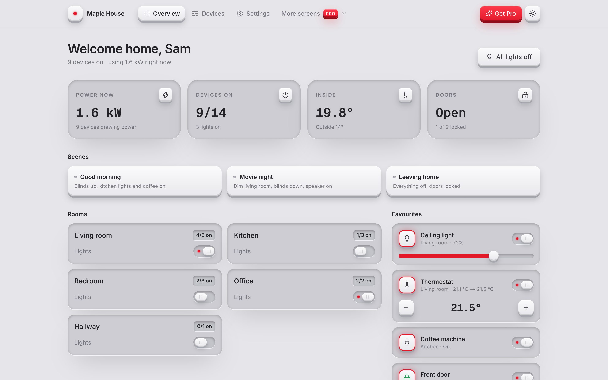

<div align="center">

# Maple House Lite

**A free smart home dashboard with controls that feel like real hardware.**<br>
Rooms, devices and scenes, in light and dark. Built with [Thock UI](https://thock-ui.vercel.app).

[](LICENSE)


[**Full version demo**](https://maple-house-demo.vercel.app) · [**Thock UI**](https://thock-ui.vercel.app) · [**Get the full template**](https://thock-ui.vercel.app/templates/smart-home)

<picture>
  <source media="(prefers-color-scheme: dark)" srcset=".github/assets/overview-dark.jpg">
  
</picture>

</div>

## At a glance

| | |
| --- | --- |
| **Screens** | 3: overview, devices, settings |
| **Looks** | Light and dark themes, works on phones and tablets |
| **Data** | A realistic demo home with rooms, lights, climate, locks and appliances |
| **Stack** | Next.js 16 (App Router), React 19, Tailwind CSS v4, Radix UI, lucide-react, next-themes |
| **Licence** | MIT: use it for anything, including commercial projects |

## Quick start

```bash
git clone https://github.com/intellaralabs/thock-smart-home-lite.git
cd thock-smart-home-lite
npm install
npm run dev        # open http://localhost:3000
```

Other scripts: `npm run build`, `npm start`, `npm run lint`.

## Screens

| Route | What it shows |
| --- | --- |
| `/` | Live power, devices on, temperature, doors, scenes, rooms with light switches, favourites, energy this week |
| `/devices` | Every device grouped by room, with search, a room picker and type filters. `?room=kitchen` opens one room |
| `/settings` | Profile, light/dark/system theme and notification switches |

## Project structure

```
app/                  layout.tsx (theme + state + shell) and one page per screen
components/ui/        Thock UI components (free, MIT; yours to edit)
components/lite/      app parts: shell, state provider, device row, screens
data/home.ts          demo data and the types the UI expects
lib/links.ts          links to the full template; set showProPreviews = false to remove them all
styles/tactile.css    design tokens: colours, raised and recessed surfaces, LEDs
```

## Connect real devices

All state lives in `components/lite/home-provider.tsx`. Screens only call `useHome()` (`update`, `updateMany`, `runScene`).

1. Load your devices from your hub (Home Assistant, SmartThings, MQTT or your own API) instead of `data/home.ts`.
2. In the provider, send each action to the hub as well as to the reducer.

## Make it yours

The "More screens" menu, the preview pages, the overview teaser, the "Get Pro" button and the footer link to the full
template. One line in `lib/links.ts` switches them all off:

```ts
export const showProPreviews = false;
```

Then you can also delete `app/pro`, `data/pro-screens.ts`, `components/lite/pro-*.tsx` and `public/pro`. To restyle,
change the colour tokens in `styles/tactile.css`.

## Lite or full?

| | Lite (free) | [Full template](https://thock-ui.vercel.app/templates/smart-home) |
| --- | :---: | :---: |
| Screens | 3 | 13 + sign-in |
| Overview, devices, settings | ✓ | ✓ |
| Light and dark, phone-ready | ✓ | ✓ |
| Rooms and room detail | | ✓ |
| Energy and solar charts | | ✓ |
| Alarm, locks and cameras | | ✓ |
| Automations wizard and scene builder | | ✓ |
| Lighting faders and colour picker | | ✓ |
| Climate knobs and heating schedule | | ✓ |
| ⌘K command menu, toasts, activity feed | | ✓ |
| Components | Free set | Free + Pro |
| Licence | MIT | Pro licence |

Try the full version: **[maple-house-demo.vercel.app](https://maple-house-demo.vercel.app)**

## Licence

[MIT](LICENSE) © Intellara Labs. Built with [Thock UI](https://thock-ui.vercel.app).
